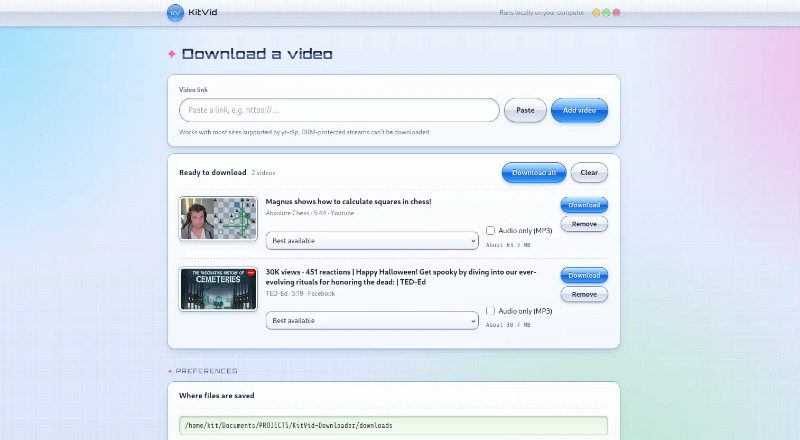
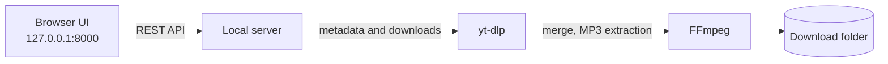

# KitVid-Downloader


A local web front end for `yt-dlp` and `FFmpeg`. Add videos to a queue, choose a format for each, track progress, and save the results to a folder you pick. Everything runs on your machine, from your IP address.

> **Legal notice:** Use this only for content you own or are allowed to save, such as Creative Commons, public domain, or a site's permitted offline use. Respect copyright and each site's terms of service. DRM-protected streams are not supported.

## Contents

- [Features](#features)
- [How it works](#how-it-works)
- [Installation](#installation)
- [Using the web interface](#using-the-web-interface)
- [Settings](#settings)
- [CLI](#cli)
- [API](#api)
- [Security model](#security-model)
- [Troubleshooting](#troubleshooting)
- [Limitations](#limitations)
- [Tests](#tests)

## Features

- Multi-video queue with a separate format and audio choice per video.
- Download all, download one, cancel, or delete jobs.
- Live progress: downloaded and total size (MB/GB), speed, and ETA.
- Size estimates before downloading, based on bitrate and duration when the site does not report a size.
- Editable download folder with a native folder chooser, saved in `settings.json`.
- Automatic cleanup of finished files after a configurable time.
- Launchers for Windows, Linux, and macOS that install what is missing on the first run and start instantly afterward.

## How it works



## Installation

### Requirements

| Requirement | Version | Purpose |
| --- | --- | --- |
| Python | 3.11 to 3.13 (3.12 recommended) | Runs the app |
| yt-dlp | Latest | Installed by `requirements.txt` |
| FFmpeg | Any recent build, on `PATH` | Merges video and audio streams, extracts MP3 |

> **Warning:** Avoid very new Python releases (3.14 or newer). Some dependencies, such as PyYAML, may not have prebuilt packages for them yet. Installation then fails with "Microsoft Visual C++ 14.0 or greater is required". See [Troubleshooting](#troubleshooting).

On Windows, `start.bat` handles both Python and FFmpeg for you:

- It looks for Python 3.11 to 3.13 and installs 3.12 if none is found.
- It looks for FFmpeg on your `PATH` or in `tools\ffmpeg`, and downloads it into `tools\ffmpeg` if neither exists.

On Linux and macOS, `start.sh` creates the virtual environment and installs the Python packages, but you install Python and FFmpeg yourself.

### Step 1: Get the project

```bash
git clone <your-repo-url> kitvid_downloader
cd kitvid_downloader
```

Without Git, download the project as a ZIP, extract it, and open the folder.

### Step 2: Install Python

<details open>
<summary>Windows</summary>

Automatic: skip this step. `start.bat` installs Python 3.12 if needed, with no admin rights required.

Manual:

1. Download Python 3.12 from <https://www.python.org/downloads/windows/>.
2. In the installer, check "Add python.exe to PATH" and click "Install Now".
3. Verify in a new terminal:

   ```bat
   py -3.12 --version
   ```

</details>

<details>
<summary>macOS</summary>

```bash
brew install python@3.12
python3.12 --version
```

</details>

<details>
<summary>Linux</summary>

```bash
# Fedora
sudo dnf install python3

# Debian / Ubuntu
sudo apt install python3 python3-venv python3-pip
```

Confirm that `python3 --version` reports 3.11 to 3.13.

</details>

### Step 3: Install FFmpeg

<details open>
<summary>Windows</summary>

Automatic: skip this step. If FFmpeg is not found, `start.bat` downloads it to `tools\ffmpeg\bin` inside the project folder (from gyan.dev, with a GitHub mirror as a fallback). It does not change your system `PATH`.

Manual (optional, if the automatic download fails or you want a system-wide install):

1. Download `ffmpeg-release-essentials.zip` from <https://www.gyan.dev/ffmpeg/builds/>.
2. Extract it so that `ffmpeg.exe` ends up at `tools\ffmpeg\bin\ffmpeg.exe` in the project folder. Alternatively, extract it to a permanent location such as `C:\ffmpeg` and add `C:\ffmpeg\bin` to your `PATH`:
   - Search for "Edit the system environment variables" and open it.
   - Click "Environment Variables", select `Path` under "User variables", then click "Edit".
   - Click "New", enter `C:\ffmpeg\bin`, and confirm every dialog.
3. Open a new terminal and verify (system-wide installs only):

   ```bat
   ffmpeg -version
   ```

If you use a package manager, any of these also works:

```bat
winget install Gyan.FFmpeg
scoop install ffmpeg
choco install ffmpeg
```

</details>

<details>
<summary>macOS</summary>

```bash
brew install ffmpeg
```

</details>

<details>
<summary>Linux</summary>

```bash
# Fedora
sudo dnf install ffmpeg

# Debian / Ubuntu
sudo apt install ffmpeg
```

</details>

### Step 4: Launch

<details open>
<summary>Windows</summary>

Double-click `start.bat`.

**Every run starts with a quick check.** If FFmpeg, the virtual environment, yt-dlp, and the packages from `requirements.txt` are all already in place, the script skips setup and starts the app right away. Nothing is downloaded or reinstalled.

**If something is missing or outdated, the script sets up only that part:**

1. Installs FFmpeg into `tools\ffmpeg` if it is not on your `PATH` or already there.
2. Finds Python 3.11 to 3.13, or installs 3.12 if none is found.
3. Creates `.venv`, and rebuilds it if it is broken or uses an unsupported Python.
4. Installs dependencies from `requirements.txt` and yt-dlp, then saves a hash of `requirements.txt` in `.venv\.deps_hash`.
5. Starts the server and opens <http://127.0.0.1:8000> in your browser.

If you edit `requirements.txt`, the hash no longer matches, so the next run reinstalls the packages once.

If you close the window or cancel while setup is running, a background watcher removes the partial FFmpeg download or virtual environment. The next run starts that step cleanly.

Keep the console window open while you use the app. Close it or press `Ctrl+C` to stop.

If the script installs Python on its first run and asks you to close the window and run it again, do so. The new `PATH` is not visible to the old window. This happens only once.

</details>

<details>
<summary>Linux and macOS</summary>

```bash
chmod +x start.sh   # first time only
./start.sh
```

**Every run starts with a quick check.** If `.venv` works, uses Python 3.11 or newer, and `requirements.txt` has not changed since the last install, the script starts the app immediately without calling pip.

**If something is missing or outdated, the script:**

1. Creates `.venv` if it is missing or broken (using `python3`, or the interpreter in the `PYTHON` environment variable).
2. Installs dependencies from `requirements.txt`.
3. Saves a hash of `requirements.txt` in `.venv/.deps_hash`.
4. Starts the server and opens the browser.

To use a specific Python:

```bash
PYTHON=/path/to/python3.12 ./start.sh
```

To set it up manually:

```bash
python3 -m venv .venv
source .venv/bin/activate
pip install -r requirements.txt
python launcher.py
```

`launcher.py` opens the browser for you. To skip auto-open, run `python -m app.main`.

</details>

### Verify the setup

- `py -3.12 --version` (or `python3 --version`) reports 3.11 to 3.13.
- `ffmpeg -version` prints a version, or `tools\ffmpeg\bin\ffmpeg.exe` exists on Windows.
- <http://127.0.0.1:8000> loads.
- Adding a test URL creates a card with a title and size estimates.

## Using the web interface

1. Set the download location at the top. Click **Browse...** to use your system's folder chooser, or type or paste a path. Changes apply to new downloads; running jobs keep their original folder.
2. Paste a URL and click **Add video**. The app fetches metadata and adds a card to the queue.
3. Choose a format, and optionally **Audio only (MP3)**, for that card. The estimated size updates.
4. Repeat for more videos, then click **Download all**, or **Download** on a single card.
5. Watch progress in the Downloads panel. Finished jobs show **Save file**. Use **Cancel** or **Delete** as needed.

## Settings

The download location is stored in `settings.json` at the project root (gitignored) and loaded at startup. If that location is unavailable or not writable, the app falls back to the default and explains the problem in the UI.

Precedence: `settings.json`, then `VD_DOWNLOAD_DIR`, then `./downloads`.

<details>
<summary>Folder chooser by operating system</summary>

The chooser opens on the machine running the server. Because the app is local-only, the dialog appears on your desktop.

| OS | Chooser |
| --- | --- |
| Linux | `zenity` or `kdialog` (Tk fallback) |
| macOS | Native dialog |
| Windows | PowerShell folder browser (Tk fallback) |

</details>

<details>
<summary>Environment variables (all optional)</summary>

| Variable | Default | Meaning |
| --- | --- | --- |
| `VD_DOWNLOAD_DIR` | `./downloads` | Initial download folder when no saved setting exists. |
| `VD_SETTINGS_FILE` | `./settings.json` | Alternate settings file path (useful for tests). |
| `VD_FILE_TTL_MINUTES` | `60` | Delete finished or errored job files after this many minutes. `0` disables cleanup. |
| `VD_MAX_CONCURRENT` | `2` | Maximum simultaneous yt-dlp processes. Extra queue items wait. |
| `VD_DOWNLOAD_TIMEOUT` | `3600` | Per-job timeout in seconds. |
| `VD_INFO_TIMEOUT` | `60` | Metadata lookup timeout in seconds. |
| `VD_MAX_FILESIZE` | unset | Passed to `yt-dlp --max-filesize`, for example `2G`. |
| `VD_ALLOW_PRIVATE_NETWORK` | `0` | Set to `1` to allow URLs that resolve to private or loopback addresses. |
| `VD_HOST` / `VD_PORT` | `127.0.0.1` / `8000` | Bind address. Keep it on loopback. |
| `VD_YTDLP` | `yt-dlp` | Path to the yt-dlp binary. `start.bat` sets this to the copy inside `.venv`. |
| `PYTHON` | `python3` | Interpreter `start.sh` uses to create `.venv`. |
| `VD_FOLDER_PICKER_FAKE` | unset | Test hook: return this folder (or `cancel`) instead of opening a chooser. |

Windows (current session):

```bat
set VD_PORT=8080
set VD_FILE_TTL_MINUTES=0
start.bat
```

Linux and macOS:

```bash
VD_PORT=8080 VD_FILE_TTL_MINUTES=0 ./start.sh
```

</details>

## CLI

```bash
python cli.py info "https://example.com/video"
python cli.py download "https://example.com/video" -f 137 --needs-audio
python cli.py download "https://example.com/video" --audio -o ~/Music
```

| Command | Description |
| --- | --- |
| `info` | Prints normalized JSON metadata and formats. |
| `download` | Downloads with yt-dlp's normal progress output. |

The CLI writes directly to `--output` and does not use the saved web setting.

## API

All endpoints return JSON unless noted. There is no authentication and no CORS, so the API is intended for `localhost` only.

| Method | Path | Description |
| --- | --- | --- |
| `GET` | `/api/health` | Liveness check. |
| `GET` | `/api/settings` | Current download folder, default, TTL, concurrency. |
| `PUT` | `/api/settings` | `{"download_dir": "..."}`. Validates, creates, and saves the folder. |
| `POST` | `/api/settings/browse` | `{"initial_dir": "..."}`. Opens the native folder chooser and returns `{"cancelled", "download_dir"}`. |
| `POST` | `/api/info` | `{"url": "..."}`. Returns title, thumbnail, duration, formats, estimated sizes, and DRM flag. |
| `GET` | `/api/jobs` | `{"jobs": [...], "active": n}`, newest first. |
| `POST` | `/api/jobs` | `{"url", "format_id", "audio_only", "needs_audio", "title"}`. Returns the job. |
| `GET` | `/api/jobs/{id}` | Job status, progress, bytes, speed, ETA, error, and download URL. |
| `GET` | `/api/jobs/{id}/file` | Serves the finished file. |
| `DELETE` | `/api/jobs/{id}` | Cancels a running or queued job, or deletes a finished one. |

<details>
<summary>Response details</summary>

- Format objects include `size_bytes`, `size_is_estimate`, and `filesize_label` (prefixed with `~` for estimates). Video-only formats include the best audio stream in their estimated total when a duration is known.
- Jobs expose `downloaded_bytes`, `total_bytes`, `total_bytes_is_estimate`, and `output_dir`.
- When `format_id` is omitted, yt-dlp uses `bestvideo+bestaudio/best`.
- Set `needs_audio: true` for video-only formats so the worker merges in the best audio stream.

</details>

## Security model

This is a local tool, not a hardened public service.

| Protection | Detail |
| --- | --- |
| Loopback binding | Binds to `127.0.0.1` by default. |
| URL validation | Rejects non-HTTP(S) URLs, embedded credentials, oversized URLs, and hosts that resolve to private, loopback, link-local, or metadata addresses. This is a best-effort SSRF guard; yt-dlp follows redirects without re-checking. |
| Format id checks | Rejects unsafe format ids so input cannot become a command-line option. |
| No shell | Arguments are passed as arrays, never through a shell. |
| Same-origin only | State-changing requests must be same-origin. No CORS headers are sent. |
| Folder chooser | A local GUI process. The chosen path is accepted only after normal settings validation. |
| Job isolation | Each job writes to its own subdirectory. File serving is restricted to that job's folder. |
| DRM | No bypass is attempted. DRM content is rejected with a clear message. |

> **Caution:** Do not expose this server to the internet or a shared network without authentication, rate limiting, per-user quotas, and stronger egress controls.

## Troubleshooting

<details>
<summary>"Microsoft Visual C++ 14.0 or greater is required" or "Failed building wheel for pyyaml"</summary>

Your Python version is too new for one of the dependencies, so pip tries to compile it from source.

1. Install Python 3.12 (see [Step 2](#step-2-install-python)).
2. Delete the `.venv` folder in the project.
3. Run `start.bat` again.

</details>

<details>
<summary>Python is not found, or "python" opens the Microsoft Store</summary>

Windows includes a placeholder `python.exe` that opens the Store. Install Python from python.org, or disable the placeholder under Settings, Apps, Advanced app settings, App execution aliases, by turning off the two Python entries.

</details>

<details>
<summary>"winget" is not recognized</summary>

winget is not required. `start.bat` downloads Python and FFmpeg itself, and the manual steps above also work. winget is provided by "App Installer" in the Microsoft Store if you want it later.

</details>

<details>
<summary>FFmpeg is not found, or MP3 and merged downloads fail</summary>

1. On Windows, run `start.bat` again. If FFmpeg is missing, it downloads it automatically. If the download fails, the script prints where to place `ffmpeg.exe`: `tools\ffmpeg\bin\ffmpeg.exe` in the project folder.
2. On Linux and macOS, run `ffmpeg -version` to check whether it is installed, and install it with your package manager if not.
3. If it is installed system-wide but not found, confirm the `bin` folder is on your `PATH`, then close and reopen your terminal so the new `PATH` is loaded.

</details>

<details>
<summary>Setup keeps failing after an interrupted install</summary>

The launcher normally cleans up partial installs on its own. If it still fails, delete the `.venv` folder (and `tools\ffmpeg` on Windows if FFmpeg is the problem) and run the launcher again to start from a clean environment.

</details>

<details>
<summary>Dependencies are not being reinstalled, or I want to force a reinstall</summary>

The launcher skips installation when `.venv\.deps_hash` (or `.venv/.deps_hash` on Linux and macOS) matches the current `requirements.txt`. Editing `requirements.txt` triggers a reinstall automatically. To force one without editing it, delete the `.deps_hash` file, or delete the whole `.venv` folder, and run the launcher again.

</details>

<details>
<summary>Port 8000 is already in use</summary>

Set a different port, for example `set VD_PORT=8080` on Windows or `VD_PORT=8080 ./start.sh` on Linux and macOS, then open the matching address.

</details>

<details>
<summary>The browser did not open</summary>

While the console window is still running, open <http://127.0.0.1:8000> manually.

</details>

<details>
<summary>A site stopped working</summary>

Sites change their players often. The launcher does not update yt-dlp once it is installed, so update it yourself inside the environment, then re-run the tests:

```bash
# Windows
.venv\Scripts\python.exe -m pip install -U yt-dlp

# Linux and macOS
.venv/bin/python -m pip install -U yt-dlp
```

</details>

<details>
<summary>Finished files disappeared</summary>

Finished and errored job files are deleted after `VD_FILE_TTL_MINUTES` (default 60). Set it to `0` to disable cleanup, or save files promptly.

</details>

## Limitations

- DRM-protected streams (Netflix, Disney+, most paid services) are unsupported.
- Sites change often. Update yt-dlp deliberately and re-run the tests.
- Some sites block datacenter or VPN IPs, or require sign-in cookies. There is no cookie UI yet.
- Playlists are disabled (`--no-playlist`). Each URL resolves to one video.
- Size estimates are approximate, especially for HLS, live streams, and videos of unknown duration.
- Jobs live in memory and are lost when the server restarts. Finished files on disk remain until you delete them.
- Finished files are served without HTTP Range support.
- Changing the download folder does not move existing files.
- `start.sh` does not install Python or FFmpeg. Only `start.bat` does that.

## Tests

```bash
python -m unittest discover -s tests -v
```

UI tests use Playwright separately and are not part of the unit test suite. Set `VD_FOLDER_PICKER_FAKE` to a folder (or `cancel`) to exercise the Browse flow without a GUI dialog.